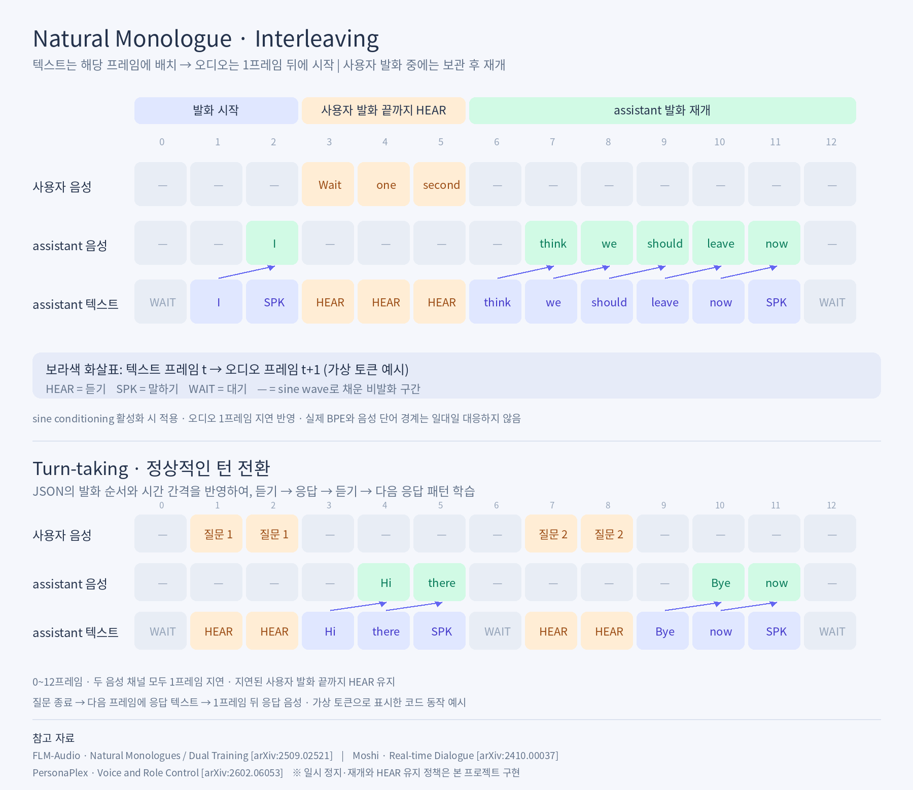

### Natural Monologue 기반 Full-Duplex 대화 모델 개선

- **현황:** Moshi 모델의 대화 연속성을 개선하고, 발화 중단·재개 및 사용자 끼어들기 대응 등 대화 동작을 명시적으로 제어할 필요가 있음.
- **개발 배경:** FLM-Audio의 연속 텍스트 생성 방식과 PersonaPlex의 자연스러운 대화 동작 학습 방향을 참고하여 Natural Monologue 기반 학습 데이터 구성 방식을 도입함.
- **개발 상세:**
  - 단어 단위 alignment 없이 발화 시작 시점부터 텍스트 토큰을 연속 배치
  - 이전 `end_time`과 다음 `start_time`이 맞닿는 assistant 발화의 텍스트를 병합하여 토큰화. 기존 오디오는 그대로 사용
  - VAD 기반 음성 구간 검출 및 `<HEAR>`·`<SPK>`·`<WAIT>` 상태 표현
  - JSON의 발화 순서와 시간 간격을 유지하여 사용자 발화 → assistant 응답 → 다음 사용자 발화 → 다음 응답의 정상적인 턴 전환 패턴 구성
  - sine conditioning 활성화 시 사용자 발화 중 assistant 텍스트·음성을 대기열에 보관하고, 사용자 발화 종료 후 순서대로 재개하는 interleaving 구성
  - 비발화 오디오 구간은 sine wave로 채우고, 기존 Moshi의 오디오 지연 패턴 적용
- **기대 효과:** 단어 단위 alignment process를 제거해 전처리를 단순화하고 정렬 오류를 줄임. 발화의 의미적 연속성과 사용자 끼어들기에 대한 대응을 함께 학습하여 자연스러운 대화 전환을 개선할 것으로 기대함. 실제 효과는 후속 비교 실험으로 검증 예정.

### Interleaving 과정

사용자 발화가 들어오면 assistant의 남은 텍스트·음성을 보관하고, 사용자 발화가 끝나면 이어서 배치하는 예시. 텍스트는 음성보다 한 프레임 앞서며, 제어 토큰은 지연 적용 후 들리는 음성 상태를 표현함. 그림은 이해를 위한 상징적 예시로, 실제 BPE 토큰과 음성 단어 경계가 일대일로 대응하지는 않음. 이 처리는 sine conditioning 옵션 활성화 시 적용됨.

그림 하단은 정상적인 턴테이킹 예시임. JSON에 기록된 발화 순서와 시간 간격에 따라 듣기 → 응답 → 듣기 → 다음 응답 패턴을 구성하며, assistant의 텍스트는 각 응답 시작 시점부터 연속 배치함. 별도 오디오를 단순 연결하는 것이 아니라 기존 WAV의 시간축에 발화 정보를 반영함.

하단 예시는 수정된 코드의 오디오 1프레임 지연과 사용자 발화 종료 대기를 반영함. 원본 사용자 활성 프레임은 0~1, 6~7이며 assistant 원본 시작은 2, 8프레임임. 지연된 사용자 음성이 끝나는 2·8프레임까지 `HEAR`를 유지하고 assistant 텍스트를 3·9프레임으로 보류함. 응답별 가상 BPE는 `[Hi, there]`, `[Bye, now]`임. 첫 질문 음성은 1~2프레임, `Hi` 텍스트는 3프레임, `Hi` 음성은 4프레임에 배치됨. 그림은 0~12프레임을 표시함. 학습 데이터 구성 시 sine conditioning을 활성화한 경우에 적용됨.

### 참고 논문

- [FLM-Audio: Natural Monologues Improve Native Full-Duplex Chatbots via Dual Training](https://arxiv.org/pdf/2509.02521)
- [PersonaPlex: Voice and Role Control for Full Duplex Conversational Speech Models](https://arxiv.org/pdf/2602.06053)
- [Moshi: a speech-text foundation model for real-time dialogue](https://arxiv.org/pdf/2410.00037)

Natural Monologue의 연속 배치는 FLM-Audio를 참고했으며, 현재 구현이 논문의 전체 Dual Training을 재현한 것은 아님. 사용자 발화에 따른 일시 정지·재개는 본 프로젝트의 데이터 구성 정책임.
